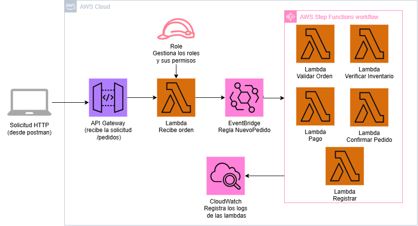

# Sistema de Procesamiento de Pedidos en AWS

## Descripción del proyecto

Este proyecto implementa un flujo para recibir y procesar pedidos utilizando servicios serverless de Amazon Web Services (AWS).

La solución recibe solicitudes HTTP, genera eventos y coordina diferentes funciones Lambda para validar la información del pedido, verificar la disponibilidad del inventario, simular el procesamiento del pago, confirmar la operación y registrar el resultado final.

El proyecto fue desarrollado como práctica académica para aplicar conceptos de computación en la nube de aws.

## Arquitectura de la solución

 

### Descripción de los servicios AWS

| Servicio | Función dentro del proyecto |
|---|---|
| **Amazon API Gateway** | Expone el endpoint HTTP que recibe las solicitudes de creación de pedidos. |
| **AWS Lambda** | Ejecuta la lógica del procesamiento mediante seis funciones independientes. |
| **Amazon EventBridge** | Recibe el evento generado al registrar un pedido y lo dirige a la máquina de estados. |
| **AWS Step Functions** | Coordina y controla la secuencia de ejecución de las funciones Lambda, incluyendo decisiones y manejo de errores. |
| **Amazon CloudWatch** | Almacena los registros de logs para facilitar el seguimiento de la ejecución. |
| **AWS IAM** | Administra los roles y permisos necesarios para la comunicación entre los servicios. |

## Flujo de procesamiento

El procesamiento del pedido sigue esta secuencia:

1. **Recepción:** se envía una solicitud HTTP mediante Postman.
2. **API Gateway:** recibe la solicitud en la ruta `POST /pedidos` y la dirige a la lambda `receive-order-paula`.
3. **Generación del evento:** la lamnda genera un identificador para el pedido y publica el evento `NuevoPedido` en Amazon EventBridge.
4. **Enrutamiento:** EventBridge identifica el evento y activa la máquina de estados de AWS Step Functions.
5. **Orquestación:** Step Functions ejecuta las funciones Lambda en el orden correspondiente al sistema de procesamiento de pedidos.

Las seis funciones están desarrolladas en Python 3.11 y se ejecutan de manera independiente. Cada una realiza una tarea específica:

| Orden | Función Lambda | Responsabilidad |
|---|---|---|
| 1 | `validate-order-paula` | Valida los datos y las condiciones del pedido. |
| 2 | `check-inventory-paula` | Verifica la disponibilidad del inventario. |
| 3 | `process-payment-paula` | Simula la aprobación o el rechazo del pago. |
| 4 | `confirm-order-paula` | Actualiza el estado del pedido a confirmado. |
| 5 | `register-audit-paula` | Consolida la información y registra el resultado final. |

El  Step Functions contempla rutas de error cuando el pedido no es válido, no hay inventario disponible o el pago es rechazado.

## Cómo utilizar la solución

### Requisitos

- Una cuenta de AWS con permisos para consultar los recursos del laboratorio.
- Una API HTTP desplegada en Amazon API Gateway.
- Postman o una herramienta compatible con solicitudes HTTP.
- El endpoint de la API disponible.

## Evidencias de funcionamiento

Se incluye un documento PDF con capturas que permiten verificar el funcionamiento de la solución:

Solicitud en Postman y respuesta de la API.

Ejecución de Step Functions.

Resultado final del pedido.

Registros de CloudWatch de las funciones de confirmación y auditoría.

Consulta el documento: [Evidencias de funcionamiento (PDF)](evidencias-funcionamiento.pdf).

## Autora

**Paula Andrea López Gómez**

Laboratorio — Sistema de Procesamiento de Pedidos en AWS.

**Tecnologías:** Amazon Web Services (AWS), Python 3.11, Amazon API Gateway, AWS Lambda, Amazon EventBridge, AWS Step Functions, Amazon CloudWatch e IAM.

[def]: architecture/arquitectura-pedidos.png